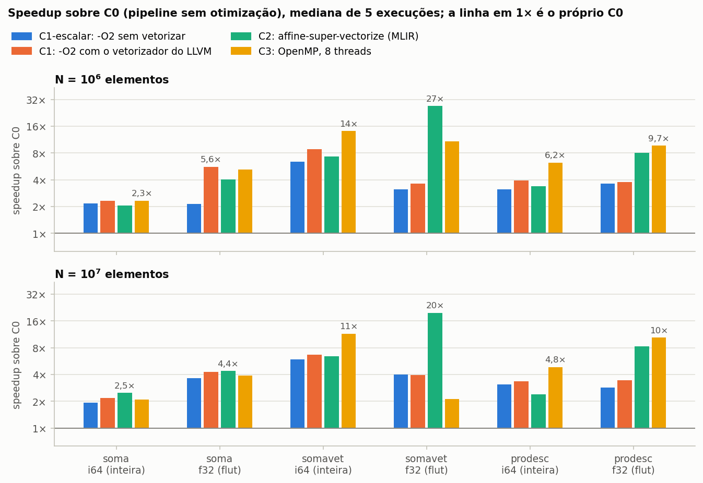
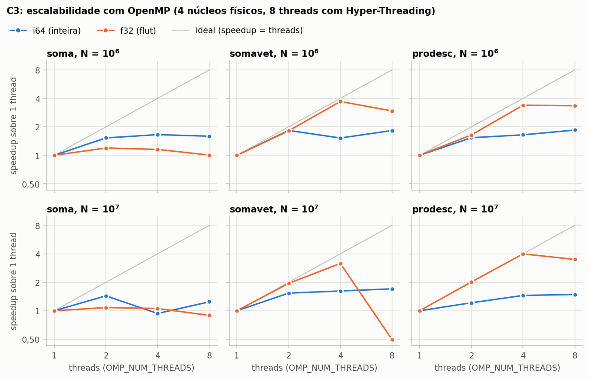
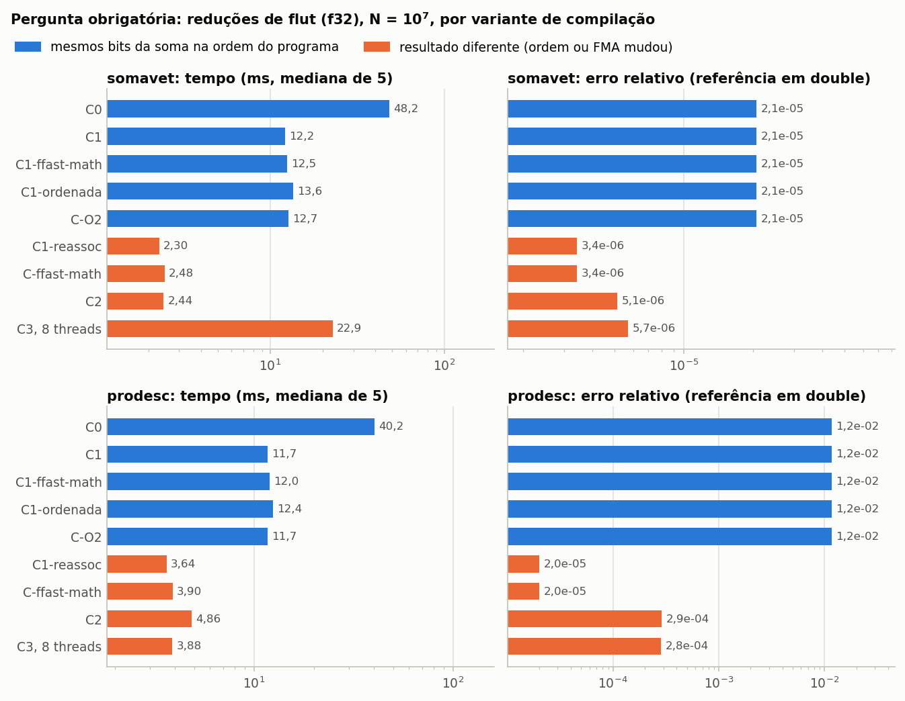
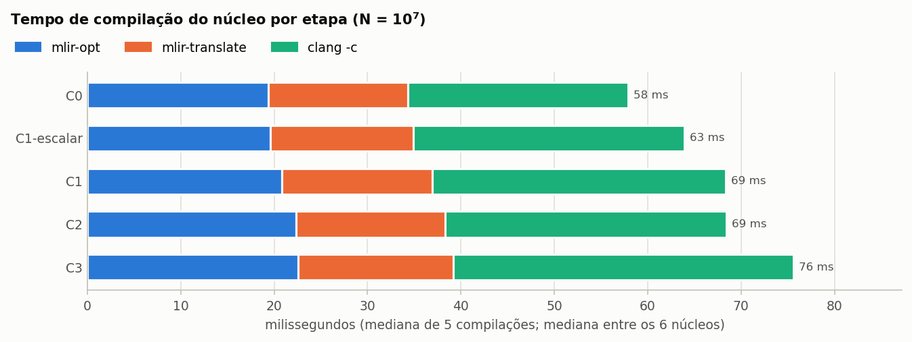

# Parte C: resultados do make bench

Gerado por `scripts/bench/graficos.py` a partir de `execucao.csv` e `compilacao.csv` (gravados por `scripts/bench/medir.py`). Não edite à mão: `make bench` regera este arquivo, os CSV e os gráficos. Cada tempo é a mediana de 5 execuções (o CSV tem as 5); a máquina completa está em `maquina.txt`.

- CPU: `Intel(R) Core(TM) i7-7700HQ CPU @ 2.80GHz`
- núcleos por soquete: `4`
- threads por núcleo: `2`
- L3: `6 MiB (1 instance)`
- -march=native: `skylake`
- extensões SIMD: `+avx +sse4.2 +avx2 -avx512vl -avx512f +fma -avx512dq`
- clang: `Ubuntu clang version 18.1.8 (20ubuntu8)`
- data (UTC): `2026-11-17 19:29:20  modo=completo`

## Tempo de execução (ms, mediana de 5)

C3·k é C3 com k threads. Só a chamada do núcleo é cronometrada.

| núcleo | N | C0 | C1-escalar | C1 | C2 | C3·1 | C3·2 | C3·4 | C3·8 |
| --- | ---: | ---: | ---: | ---: | ---: | ---: | ---: | ---: | ---: |
| soma i64 | 10⁶ | 2,792 | 1,286 | 1,208 | 1,359 | 1,915 | 1,254 | 1,157 | 1,202 |
| soma f32 | 10⁶ | 2,914 | 1,355 | 0,519 | 0,718 | 0,561 | 0,470 | 0,486 | 0,558 |
| somavet i64 | 10⁶ | 3,197 | 0,501 | 0,361 | 0,434 | 0,414 | 0,226 | 0,272 | 0,226 |
| somavet f32 | 10⁶ | 4,174 | 1,331 | 1,153 | 0,154 | 1,135 | 0,626 | 0,306 | 0,386 |
| prodesc i64 | 10⁶ | 3,041 | 0,976 | 0,771 | 0,892 | 0,901 | 0,588 | 0,548 | 0,487 |
| prodesc f32 | 10⁶ | 4,198 | 1,153 | 1,112 | 0,525 | 1,449 | 0,882 | 0,428 | 0,433 |
| soma i64 | 10⁷ | 32,736 | 16,889 | 15,046 | 13,155 | 19,346 | 13,468 | 20,675 | 15,572 |
| soma f32 | 10⁷ | 28,910 | 7,923 | 6,742 | 6,590 | 6,657 | 6,159 | 6,306 | 7,451 |
| somavet i64 | 10⁷ | 30,268 | 5,121 | 4,562 | 4,717 | 4,488 | 2,921 | 2,775 | 2,632 |
| somavet f32 | 10⁷ | 48,192 | 11,981 | 12,185 | 2,442 | 11,309 | 5,813 | 3,572 | 22,851 |
| prodesc i64 | 10⁷ | 29,670 | 9,531 | 8,842 | 12,391 | 9,091 | 7,488 | 6,262 | 6,119 |
| prodesc f32 | 10⁷ | 40,232 | 14,125 | 11,672 | 4,862 | 13,516 | 6,704 | 3,387 | 3,876 |

## Speedup sobre C0

| núcleo | N | C0 | C1-escalar | C1 | C2 | C3·1 | C3·2 | C3·4 | C3·8 |
| --- | ---: | ---: | ---: | ---: | ---: | ---: | ---: | ---: | ---: |
| soma i64 | 10⁶ | 1,00× | 2,17× | 2,31× | 2,05× | 1,46× | 2,23× | 2,41× | 2,32× |
| soma f32 | 10⁶ | 1,00× | 2,15× | 5,62× | 4,06× | 5,19× | 6,21× | 6,00× | 5,22× |
| somavet i64 | 10⁶ | 1,00× | 6,38× | 8,86× | 7,36× | 7,73× | 14,16× | 11,77× | 14,14× |
| somavet f32 | 10⁶ | 1,00× | 3,14× | 3,62× | 27,09× | 3,68× | 6,67× | 13,63× | 10,83× |
| prodesc i64 | 10⁶ | 1,00× | 3,12× | 3,94× | 3,41× | 3,37× | 5,18× | 5,55× | 6,24× |
| prodesc f32 | 10⁶ | 1,00× | 3,64× | 3,78× | 7,99× | 2,90× | 4,76× | 9,80× | 9,69× |
| soma i64 | 10⁷ | 1,00× | 1,94× | 2,18× | 2,49× | 1,69× | 2,43× | 1,58× | 2,10× |
| soma f32 | 10⁷ | 1,00× | 3,65× | 4,29× | 4,39× | 4,34× | 4,69× | 4,58× | 3,88× |
| somavet i64 | 10⁷ | 1,00× | 5,91× | 6,63× | 6,42× | 6,74× | 10,36× | 10,91× | 11,50× |
| somavet f32 | 10⁷ | 1,00× | 4,02× | 3,95× | 19,74× | 4,26× | 8,29× | 13,49× | 2,11× |
| prodesc i64 | 10⁷ | 1,00× | 3,11× | 3,36× | 2,39× | 3,26× | 3,96× | 4,74× | 4,85× |
| prodesc f32 | 10⁷ | 1,00× | 2,85× | 3,45× | 8,27× | 2,98× | 6,00× | 11,88× | 10,38× |

## Banda efetiva (GB/s)

Bytes dos vetores percorridos por chamada (soma: 3 vetores; prodesc: 2; somavet: 1) divididos pelo tempo.

| núcleo | N | C0 | C1-escalar | C1 | C2 | C3·1 | C3·2 | C3·4 | C3·8 |
| --- | ---: | ---: | ---: | ---: | ---: | ---: | ---: | ---: | ---: |
| soma i64 | 10⁶ | 8,6 | 18,7 | 19,9 | 17,7 | 12,5 | 19,1 | 20,7 | 20,0 |
| soma f32 | 10⁶ | 4,1 | 8,8 | 23,1 | 16,7 | 21,4 | 25,6 | 24,7 | 21,5 |
| somavet i64 | 10⁶ | 2,5 | 16,0 | 22,2 | 18,4 | 19,3 | 35,5 | 29,5 | 35,4 |
| somavet f32 | 10⁶ | 1,0 | 3,0 | 3,5 | 26,0 | 3,5 | 6,4 | 13,1 | 10,4 |
| prodesc i64 | 10⁶ | 5,3 | 16,4 | 20,8 | 17,9 | 17,8 | 27,2 | 29,2 | 32,8 |
| prodesc f32 | 10⁶ | 1,9 | 6,9 | 7,2 | 15,2 | 5,5 | 9,1 | 18,7 | 18,5 |
| soma i64 | 10⁷ | 7,3 | 14,2 | 15,9 | 18,2 | 12,4 | 17,8 | 11,6 | 15,4 |
| soma f32 | 10⁷ | 4,2 | 15,2 | 17,8 | 18,2 | 18,0 | 19,5 | 19,0 | 16,1 |
| somavet i64 | 10⁷ | 2,6 | 15,6 | 17,5 | 17,0 | 17,8 | 27,4 | 28,8 | 30,4 |
| somavet f32 | 10⁷ | 0,8 | 3,3 | 3,3 | 16,4 | 3,5 | 6,9 | 11,2 | 1,8 |
| prodesc i64 | 10⁷ | 5,4 | 16,8 | 18,1 | 12,9 | 17,6 | 21,4 | 25,6 | 26,1 |
| prodesc f32 | 10⁷ | 2,0 | 5,7 | 6,8 | 16,4 | 5,9 | 11,9 | 23,6 | 20,6 |

## Dispersão das repetições

(máximo − mínimo) / mediana: mediana 16,9%, pior caso 204,3% em 116 medições.

## C3: speedup sobre 1 thread

Eficiência = speedup / threads. A máquina tem 4 núcleos físicos; 8 threads usam o Hyper-Threading.

| núcleo | N | 1 thr. | 2 thr. | 4 thr. | 8 thr. | efic. 4 | efic. 8 | GB/s com 8 |
| --- | ---: | ---: | ---: | ---: | ---: | ---: | ---: | ---: |
| soma i64 | 10⁶ | 1,00× | 1,53× | 1,65× | 1,59× | 41% | 20% | 20,0 |
| soma f32 | 10⁶ | 1,00× | 1,19× | 1,15× | 1,01× | 29% | 13% | 21,5 |
| somavet i64 | 10⁶ | 1,00× | 1,83× | 1,52× | 1,83× | 38% | 23% | 35,4 |
| somavet f32 | 10⁶ | 1,00× | 1,81× | 3,71× | 2,94× | 93% | 37% | 10,4 |
| prodesc i64 | 10⁶ | 1,00× | 1,53× | 1,65× | 1,85× | 41% | 23% | 32,8 |
| prodesc f32 | 10⁶ | 1,00× | 1,64× | 3,38× | 3,35× | 85% | 42% | 18,5 |
| soma i64 | 10⁷ | 1,00× | 1,44× | 0,94× | 1,24× | 23% | 16% | 15,4 |
| soma f32 | 10⁷ | 1,00× | 1,08× | 1,06× | 0,89× | 26% | 11% | 16,1 |
| somavet i64 | 10⁷ | 1,00× | 1,54× | 1,62× | 1,70× | 40% | 21% | 30,4 |
| somavet f32 | 10⁷ | 1,00× | 1,95× | 3,17× | 0,49× | 79% | 6% | 1,8 |
| prodesc i64 | 10⁷ | 1,00× | 1,21× | 1,45× | 1,49× | 36% | 19% | 26,1 |
| prodesc f32 | 10⁷ | 1,00× | 2,02× | 3,99× | 3,49× | 100% | 44% | 20,6 |

## Pergunta obrigatória: reduções de flut

Δ ordem = resultado − soma sequencial em f32 (a ordem do programa); erro = |resultado − referência| / referência, com a referência em double e soma compensada. "Mesmos bits" diz se o resultado é idêntico ao da ordem do programa.

### somavet f32, N = 10⁶

| variante | ms | speedup sobre C1 | resultado | Δ ordem | erro | mesmos bits | estável |
| --- | ---: | ---: | ---: | ---: | ---: | ---: | ---: |
| C0 | 4,174 | 0,28× | 499869,312 | 0,000 | 8,66e-06 | sim | sim |
| C1 | 1,153 | 1,00× | 499869,312 | 0,000 | 8,66e-06 | sim | sim |
| C1-ffast-math | 1,158 | 1,00× | 499869,312 | 0,000 | 8,66e-06 | sim | sim |
| C1-ordenada | 1,217 | 0,95× | 499869,312 | 0,000 | 8,66e-06 | sim | sim |
| C-O2 | 1,155 | 1,00× | 499869,312 | 0,000 | 8,66e-06 | sim | sim |
| C1-reassoc | 0,146 | 7,89× | 499864,938 | -4,374 | 9,03e-08 | não | sim |
| C-ffast-math | 0,086 | 13,33× | 499864,938 | -4,374 | 9,03e-08 | não | sim |
| C2 | 0,154 | 7,48× | 499865,281 | -4,031 | 5,96e-07 | não | sim |
| C3, 1 thread | 1,135 | 1,02× | 499869,312 | 0,000 | 8,66e-06 | sim | sim |
| C3, 2 threads | 0,626 | 1,84× | 499864,844 | -4,468 | 2,78e-07 | não | sim |
| C3, 4 threads | 0,306 | 3,77× | 499863,75 | -5,562 | 2,47e-06 | não | sim |
| C3, 8 threads | 0,386 | 2,99× | 499865,125 | -4,187 | 2,84e-07 | não | sim |

### prodesc f32, N = 10⁶

| variante | ms | speedup sobre C1 | resultado | Δ ordem | erro | mesmos bits | estável |
| --- | ---: | ---: | ---: | ---: | ---: | ---: | ---: |
| C0 | 4,198 | 0,26× | 249730,266 | 0,000 | 1,41e-04 | sim | sim |
| C1 | 1,112 | 1,00× | 249730,266 | 0,000 | 1,41e-04 | sim | sim |
| C1-ffast-math | 1,203 | 0,92× | 249730,266 | 0,000 | 1,41e-04 | sim | sim |
| C1-ordenada | 1,123 | 0,99× | 249730,266 | 0,000 | 1,41e-04 | sim | sim |
| C-O2 | 1,826 | 0,61× | 249730,266 | 0,000 | 1,41e-04 | sim | sim |
| C1-reassoc | 0,365 | 3,04× | 249765,281 | 35,015 | 1,00e-06 | não | sim |
| C-ffast-math | 0,410 | 2,71× | 249765,281 | 35,015 | 1,00e-06 | não | sim |
| C2 | 0,525 | 2,12× | 249764,438 | 34,172 | 4,38e-06 | não | sim |
| C3, 1 thread | 1,449 | 0,77× | 249730,266 | 0,000 | 1,41e-04 | sim | sim |
| C3, 2 threads | 0,882 | 1,26× | 249754,125 | 23,859 | 4,57e-05 | não | sim |
| C3, 4 threads | 0,428 | 2,59× | 249762,375 | 32,109 | 1,26e-05 | não | não |
| C3, 8 threads | 0,433 | 2,57× | 249764,344 | 34,078 | 4,76e-06 | não | sim |

### somavet f32, N = 10⁷

| variante | ms | speedup sobre C1 | resultado | Δ ordem | erro | mesmos bits | estável |
| --- | ---: | ---: | ---: | ---: | ---: | ---: | ---: |
| C0 | 48,192 | 0,25× | 4999525,5 | 0,000 | 2,07e-05 | sim | sim |
| C1 | 12,185 | 1,00× | 4999525,5 | 0,000 | 2,07e-05 | sim | sim |
| C1-ffast-math | 12,458 | 0,98× | 4999525,5 | 0,000 | 2,07e-05 | sim | sim |
| C1-ordenada | 13,550 | 0,90× | 4999525,5 | 0,000 | 2,07e-05 | sim | sim |
| C-O2 | 12,736 | 0,96× | 4999525,5 | 0,000 | 2,07e-05 | sim | sim |
| C1-reassoc | 2,305 | 5,29× | 4999405 | -120,500 | 3,42e-06 | não | sim |
| C-ffast-math | 2,476 | 4,92× | 4999405 | -120,500 | 3,42e-06 | não | sim |
| C2 | 2,442 | 4,99× | 4999396,5 | -129,000 | 5,12e-06 | não | sim |
| C3, 1 thread | 11,309 | 1,08× | 4999525,5 | 0,000 | 2,07e-05 | sim | sim |
| C3, 2 threads | 5,813 | 2,10× | 4999579 | 53,500 | 3,14e-05 | não | sim |
| C3, 4 threads | 3,572 | 3,41× | 4999446 | -79,500 | 4,78e-06 | não | não |
| C3, 8 threads | 22,851 | 0,53× | 4999393,5 | -132,000 | 5,72e-06 | não | sim |

### prodesc f32, N = 10⁷

| variante | ms | speedup sobre C1 | resultado | Δ ordem | erro | mesmos bits | estável |
| --- | ---: | ---: | ---: | ---: | ---: | ---: | ---: |
| C0 | 40,232 | 0,29× | 2470720 | 0,000 | 1,16e-02 | sim | sim |
| C1 | 11,672 | 1,00× | 2470720 | 0,000 | 1,16e-02 | sim | sim |
| C1-ffast-math | 12,002 | 0,97× | 2470720 | 0,000 | 1,16e-02 | sim | sim |
| C1-ordenada | 12,438 | 0,94× | 2470720 | 0,000 | 1,16e-02 | sim | sim |
| C-O2 | 11,732 | 0,99× | 2470720 | 0,000 | 1,16e-02 | sim | sim |
| C1-reassoc | 3,638 | 3,21× | 2499716,5 | 28.996,500 | 2,02e-05 | não | sim |
| C-ffast-math | 3,901 | 2,99× | 2499716,5 | 28.996,500 | 2,02e-05 | não | sim |
| C2 | 4,862 | 2,40× | 2499044,25 | 28.324,250 | 2,89e-04 | não | sim |
| C3, 1 thread | 13,516 | 0,86× | 2470720 | 0,000 | 1,16e-02 | sim | sim |
| C3, 2 threads | 6,704 | 1,74× | 2491205 | 20.485,000 | 3,43e-03 | não | sim |
| C3, 4 threads | 3,387 | 3,45× | 2497342,25 | 26.622,250 | 9,70e-04 | não | sim |
| C3, 8 threads | 3,876 | 3,01× | 2499057 | 28.337,000 | 2,84e-04 | não | sim |

## Tempo de compilação do núcleo (ms)

Mediana de 5 compilações de cada núcleo e, na tabela, a mediana entre os núcleos. Cada etapa é um processo (inclui o tempo de carregar a ferramenta). Em C-O2 o núcleo é C, então só há clang.

| config | N | mlir-opt | mlir-translate | clang -c | total |
| --- | ---: | ---: | ---: | ---: | ---: |
| C0 | 10⁶ | 19,4 | 15,4 | 24,3 | 60,0 |
| C1-escalar | 10⁶ | 19,4 | 15,3 | 28,8 | 64,0 |
| C1 | 10⁶ | 19,5 | 16,2 | 30,6 | 66,3 |
| C2 | 10⁶ | 21,2 | 15,7 | 30,7 | 67,4 |
| C3 | 10⁶ | 23,2 | 17,1 | 38,4 | 77,9 |
| C1-reassoc | 10⁶ | 19,9 | 16,0 | 30,0 | 66,6 |
| C-O2 | 10⁶ | 0,0 | 0,0 | 31,8 | 31,8 |
| C0 | 10⁷ | 19,4 | 14,9 | 23,6 | 58,3 |
| C1-escalar | 10⁷ | 19,6 | 15,3 | 29,0 | 63,5 |
| C1 | 10⁷ | 20,8 | 16,2 | 31,4 | 68,9 |
| C2 | 10⁷ | 22,4 | 15,9 | 30,1 | 69,4 |
| C3 | 10⁷ | 22,6 | 16,6 | 36,4 | 75,8 |
| C1-reassoc | 10⁷ | 19,8 | 16,2 | 30,3 | 66,3 |
| C-O2 | 10⁷ | 0,0 | 0,0 | 32,2 | 32,2 |

## Gráficos

