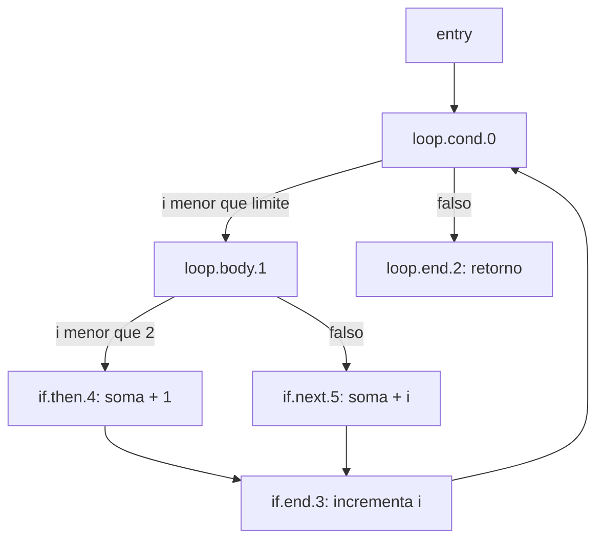

# LLVM, SSA e otimizações no PjBL 3

## Exemplo e ambiente verificado

O programa [ssa.mac](../examples/ssa.mac) lê um limite e chama `acumula`.
A função começa com `i = 0` e `soma = 0`; em cada iteração, soma 1 quando
`i < 2`, ou soma `i` nos demais casos, e incrementa `i`. O limite vem de
`stdin`, portanto o otimizador não conhece sua entrada antecipadamente.

Os resultados abaixo foram obtidos em 3 de novembro de 2026, no Windows
x86-64 com LLVM/Clang 22.1.8 do MSYS2 UCRT64. São evidências de execução
dessa versão, não uma garantia de que outra versão produzirá os mesmos
nomes de temporários ou a mesma forma de CFG.

```sh
mkdir -p build/ssa
./build/debug/macaronica examples/ssa.mac -o build/ssa/original.ll
llvm-as build/ssa/original.ll -o build/ssa/original.bc
opt -passes=verify build/ssa/original.ll -disable-output
opt -S -passes=mem2reg build/ssa/original.ll -o build/ssa/mem2reg.ll
opt -S -O2 build/ssa/original.ll -o build/ssa/O2.ll
```

As três variantes foram aceitas por `llvm-as` e `opt -passes=verify`.
O gerador emite LLVM diretamente da AST anotada: não existe uma IR própria
em 3AC ou DAG. Esses conceitos ajudam a reconhecer dependências de valores,
mas não acrescentam uma etapa de representação ao compilador.

## Da memória para SSA

A IR original aloca o parâmetro `limite` e os locais `i` e `soma` no bloco
`entry`. Por exemplo, `soma receba soma + 1` aparece como:

```llvm
if.then.4:
  %t.5 = load i32, ptr %v.13.addr
  %t.6 = add i32 %t.5, 1
  store i32 %t.6, ptr %v.13.addr
  br label %if.end.3
```

Os resultados de instruções, como `%t.6`, já possuem uma única definição.
Entretanto, o conteúdo de `%v.13.addr` muda por `store`. `mem2reg` elimina
esse armazenamento quando o endereço não escapa e os usos permitem a promoção.
Ele substitui as leituras por versões SSA e reúne valores de predecessores
com `phi`. Não é necessário implementar essa promoção manualmente em C.

Neste exemplo, o CFG da função é:



Depois de `mem2reg`, os dois `phi` do cabeçalho guardam as versões de `i`
e `soma` que chegam pela entrada inicial ou pela aresta de retorno do laço:

```llvm
loop.cond.0:
  %v.12.addr.0 = phi i32 [ 0, %entry ], [ %t.11, %if.end.3 ]
  %v.13.addr.0 = phi i32 [ 0, %entry ], [ %v.13.addr.1, %if.end.3 ]
  %t.2 = icmp slt i32 %v.12.addr.0, %arg.0
  br i1 %t.2, label %loop.body.1, label %loop.end.2
```

O terceiro `phi` reúne as duas atribuições de `soma` na condicional:

```llvm
if.end.3:
  %v.13.addr.1 = phi i32 [ %t.6, %if.then.4 ], [ %t.9, %if.next.5 ]
  %t.11 = add i32 %v.12.addr.0, 1
  br label %loop.cond.0
```

`phi` escolhe o valor associado à aresta pela qual o controle entrou no
bloco. Não avalia uma condição nova nem executa os dois ramos. Cada rótulo
listado precisa ser um predecessor real desse bloco. O valor inicial de
`limite` passa a ser usado diretamente como `%arg.0`; ele não precisa de
`phi`, pois não é reatribuído.

Contagem das instruções no módulo gerado, excluindo o runtime:

| Variante | `alloca` | `load` | `store` | `phi` |
|---|---:|---:|---:|---:|
| Original | 3 | 8 | 8 | 0 |
| `mem2reg` | 0 | 0 | 0 | 3 |
| `-O2` | 0 | 0 | 0 | 4 |

A promoção depende dos usos do objeto, não apenas de ele ser local. Vetores
indexados e campos acessados por endereço podem continuar em memória; uma
operação sobre agregado também pode ser transformada por outros passes.
`mem2reg` não é uma garantia de remover todo `alloca` de qualquer programa.

## O que mudou com `-O2`

Na execução observada, `-O2` eliminou declarações de runtime não utilizadas,
promoveu os locais, separou casos iniciais do laço e incorporou uma cópia da
função `acumula` dentro de `zl_principal`. Na cópia incorporada, substituiu o
laço por um cálculo aritmético equivalente para o limite recebido. Um trecho
da saída é:

```llvm
  %0 = shl nuw i32 %t.0, 1
  %1 = add nsw i32 %t.0, -2
  %2 = zext nneg i32 %1 to i33
  %3 = add nsw i32 %t.0, -3
  %4 = zext i32 %3 to i33
  %5 = mul i33 %2, %4
  %6 = lshr i33 %5, 1
  %7 = trunc nuw i33 %6 to i32
  %8 = add i32 %0, %7
  %9 = add i32 %8, -2
```

Isso ilustra simplificação de controle, análise de recorrências e redução
de trabalho repetido. A observação da saída final não identifica, sozinha,
qual passe individual foi responsável por cada instrução. Para atribuir uma
mudança a um passe, é necessário examinar, por exemplo, `-print-after-all`.

O aumento de três para quatro `phi` não significa piora: o CFG foi transformado
e há uma cópia incorporada do cálculo, enquanto a função original continua
disponível no módulo. Quantidade de instruções isolada não mede desempenho.
Não foi feito benchmark de tempo nesta análise.

O gerador não acrescenta `nsw` ou `nuw` à aritmética modular da fonte.
O LLVM pode introduzir esses atributos quando demonstra os limites de uma
operação no contexto do CFG, como no incremento de uma variável limitada
pelo controle do laço. A transformação deve preservar a semântica modular
documentada, sem presumir que todos os inteiros da fonte não transbordam.

## Equivalência observada

As variantes original, `mem2reg` e `-O2` foram executadas tanto por `lli`
quanto por executáveis Clang ligados com `zl_runtime_posix.c`:

| Entrada | Saída, seguida de nova linha | Status |
|---:|---:|---:|
| -2 | 0 | 0 |
| 0 | 0 | 0 |
| 1 | 1 | 0 |
| 2 | 2 | 0 |
| 5 | 11 | 0 |
| 8 | 29 | 0 |

Foram comparadas 36 execuções: três variantes, seis entradas e dois modos
de execução. Todas apresentaram a saída e o status esperados. Isso verifica
os casos listados e não constitui uma prova formal para todas as entradas.

A ligação nativa de cada variante usa:

```sh
clang build/ssa/original.ll runtime/zl_runtime_posix.c -lm -o build/ssa/original
clang build/ssa/mem2reg.ll runtime/zl_runtime_posix.c -lm -o build/ssa/mem2reg
clang build/ssa/O2.ll runtime/zl_runtime_posix.c -lm -o build/ssa/O2
```

No Windows, use `.exe`. Para `lli`, o modo de carregar o runtime depende do
hospedeiro; veja [decisoes_backend.md](decisoes_backend.md). O LLVM/Clang UCRT64
22.1.8 apresentou problemas ao resolver funções da biblioteca C no runtime em
bitcode. A execução verificada usa o runtime em DLL nativa e o ponto de entrada
`zl_principal`, preservando a IR original sem triple ou detalhes de placa.
As 18 execuções JIT da tabela foram repetidas com a DLL construída diretamente
do runtime, sem stub ou cópia do programa dentro da biblioteca:

```sh
clang -std=c99 -Wall -Wextra -pedantic -shared -DZL_RUNTIME_NO_MAIN \
  runtime/zl_runtime_posix.c -lm -Wl,--export-all-symbols -o build/ssa/runtime.dll
printf '5\n' | lli --entry-function=zl_principal \
  --dlopen=build/ssa/runtime.dll build/ssa/original.ll
printf '5\n' | lli --entry-function=zl_principal \
  --dlopen=build/ssa/runtime.dll build/ssa/mem2reg.ll
printf '5\n' | lli --entry-function=zl_principal \
  --dlopen=build/ssa/runtime.dll build/ssa/O2.ll
```

Cada comando imprime `11` e retorna zero. A macro exclui somente o `main` do
runtime nessa forma de carregamento; as funções `zl_*` permanecem as mesmas
usadas na ligação nativa. O diretório das DLLs da toolchain deve estar no
`PATH` do processo.

## Relação com as aulas e arguição

- **Bloco básico:** sequência com entrada pelo rótulo e término por um
  terminador. `br`, `ret` e `unreachable` encerram blocos; não pode haver
  instruções executáveis depois deles no mesmo bloco.
- **CFG:** cada `br` cria arestas. Os predecessores explicam os operandos de
  cada `phi`; a ordem textual dos blocos não define a ordem de execução.
- **SSA:** cada resultado de instrução possui uma única definição. Uma
  variável mutável da fonte pode corresponder a várias versões SSA.
- **DCE e efeitos:** as chamadas de impressão e leitura continuam observáveis.
  Uma expressão cujo resultado não é usado pode ainda precisar ser executada
  se causar efeitos ou erro de execução.
- **Propagação e simplificação:** os zeros iniciais entram diretamente nos
  `phi`; usos do parâmetro substituem cargas de memória. `-O2` pode alterar
  profundamente o CFG sem alterar a saída.
- **Cautela numérica:** simplificações inteiras dependem da largura e da
  semântica modular. Ponto flutuante não obedece a todas as identidades reais;
  o projeto não habilita `fast-math`.

Perguntas para preparar:

1. Por que os `alloca` ficam no bloco `entry`? Quais usos impedem promoção?
2. Por que há dois `phi` no cabeçalho e um no encontro da condicional?
3. Qual valor é escolhido no cabeçalho na primeira iteração e nas seguintes?
4. Por que o parâmetro `limite` não precisa de `phi`?
5. Um `phi` escolhe pelo valor de uma condição ou pelo predecessor percorrido?
6. Por que um aumento na contagem de `phi` após `-O2` não implica piora?
7. O que permite substituir esse laço por aritmética? Como efeitos colaterais
   dentro do laço mudariam a possibilidade de transformação?
8. Por que o LLVM pode provar `nsw` em uma instrução otimizada se o gerador
   preserva operações modulares sem esse atributo?
9. O que os testes de equivalência demonstram e o que ainda não provam?
